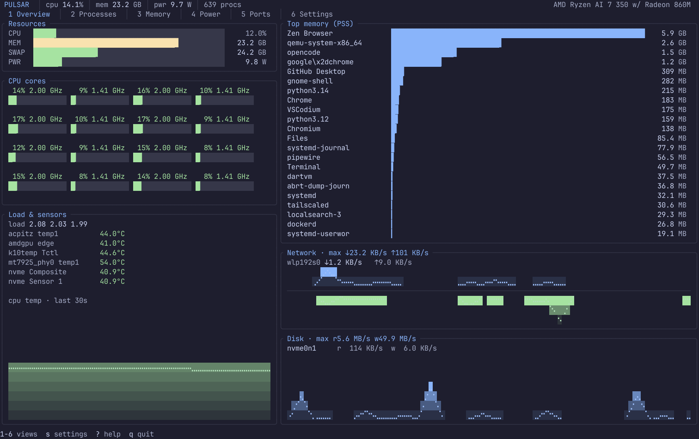
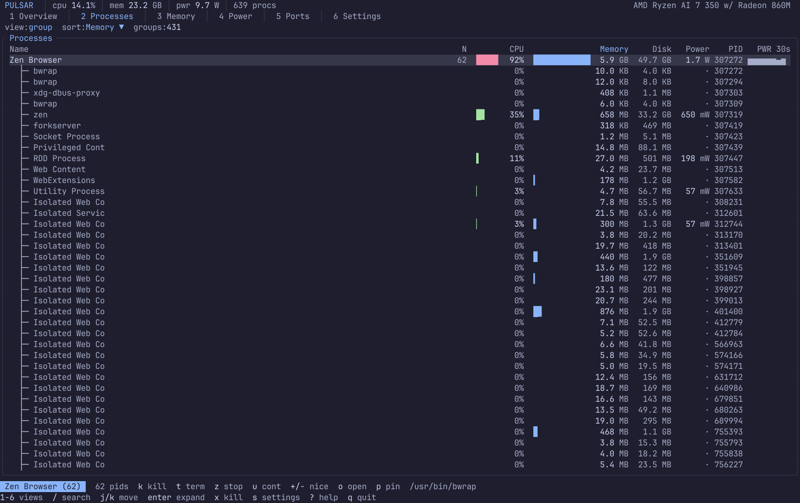
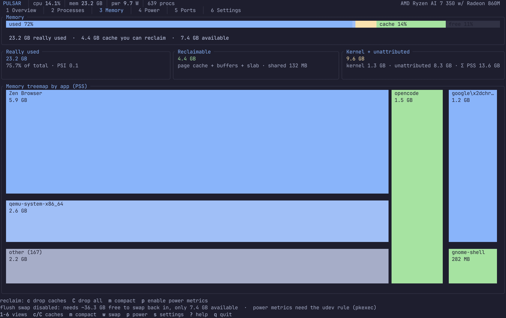
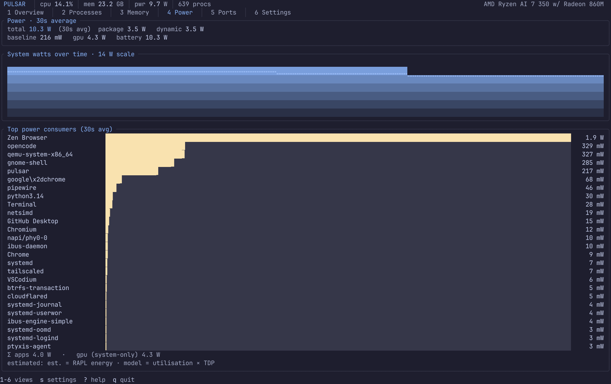
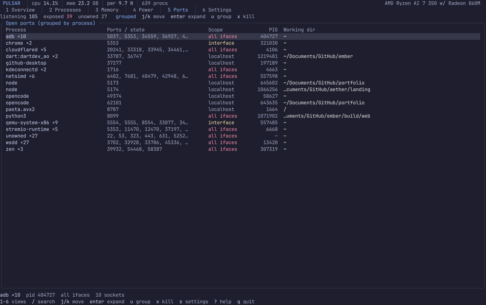

<div align="center">

# Pulsar

**A terminal-native Linux system monitor with memory that adds up, processes grouped like Task Manager, and honest per-app power.**


<br>



<br>

`~7 MB RSS` · `~1.8 MB binary` · `570 processes @ 1 Hz` · `no webview, no GUI toolkit`

</div>

---

## Why

GNOME System Monitor and Resources disagree with themselves. The header says 10.3 GB used while the process list sums to ~3.4 GB, because per-process numbers are RSS-shaped and ignore shared pages and kernel memory. Pulsar fixes three things:

| | |
|---|---|
| **Memory that reconciles** | Every byte is accounted for: used, cache, shared, kernel, free. Per-process PSS sums to the header. |
| **Grouped processes** | Multi-process apps fold into one expandable row, like Windows Task Manager. |
| **Per-app power** | CPU watts from RAPL or a utilisation × TDP model, GPU and battery from sysfs. Always labelled `est.` or `model`, never faked. |

## Views

<table>
<tr>
<td width="50%"><br><sub><b>2 · Processes</b> — grouped / flat / tree, sortable, expandable</sub></td>
<td width="50%"><br><sub><b>3 · Memory</b> — reconciliation panels and treemap by app</sub></td>
</tr>
<tr>
<td width="50%"><br><sub><b>4 · Power</b> — system watts, breakdown, top consumers</sub></td>
<td width="50%"><br><sub><b>5 · Ports</b> — listening sockets by process, exposure at a glance</sub></td>
</tr>
</table>

| # | View | Contents |
|---|------|----------|
| 1 | **Overview** | CPU / memory / swap / power gauges, per-core grid with frequency, load, temperatures, top memory, network, disk |
| 2 | **Processes** | Grouped / flat / tree table; sort by CPU, PSS, disk IO, power, PID; search, pin, kernel-thread toggle, action bar |
| 3 | **Memory** | Stacked bar, plain-language summary, three reconciliation panels, interactive treemap, Reclaim panel |
| 4 | **Power** | System watts over time, package / dynamic / baseline / GPU / battery breakdown, top consumers, cumulative Wh |
| 5 | **Ports** | Listening TCP and bound UDP, grouped by process, with scope, PID and working directory |
| 6 | **Settings** | Theme, refresh, smoothing, TDP override, history and more, all live |

## Install

```sh
git clone https://github.com/devansharora18/pulsar
cd pulsar
cargo install --path app
```

or just build it:

```sh
cargo build --release
./target/release/pulsar
```

**Requires** Linux with `/proc` and cgroup v2 (any modern distro) and Rust ≥ 1.75 to build.

Packaging lives in [`packaging/`](packaging): `.desktop` launcher, SVG icon, RAPL udev rule, `PKGBUILD`, Flatpak manifest.

### Measured CPU power (optional)

RAPL energy counters are root-only since Linux 5.10. Without access, Pulsar uses the utilisation × TDP model. To get measured values, install the udev rule:

```sh
sudo cp packaging/99-pulsar-rapl.rules /etc/udev/rules.d/
sudo udevadm control --reload-rules && sudo udevadm trigger --subsystem-match=powercap
```

or press `p` in the Memory view, which applies it via `pkexec`.

## Keys

<table>
<tr><td valign="top">

**Global**

| Key | Action |
|---|---|
| `1`–`6` / `Tab` | Switch view |
| `/` | Search |
| `j` `k` / arrows | Move |
| `Enter` | Expand / collapse |
| `s` | Settings |
| `a` | Activity log |
| `r` | Reload config + theme |
| `?` | Help |
| `q` | Quit |

</td><td valign="top">

**Processes**

| Key | Action |
|---|---|
| `x` | Kill group |
| `t` | Terminate |
| `z` / `u` | Suspend / resume |
| `+` `-` | Renice |
| `o` | Open exe location |
| `p` | Pin |
| `g` `f` `t` | Group / flat / tree |
| `S` / `R` | Cycle sort / reverse |
| `h` | Hide kernel threads |

</td><td valign="top">

**Memory · Ports**

| Key | Action |
|---|---|
| `c` / `C` | Drop clean caches / all |
| `m` | Compact memory |
| `w` | Flush swap |
| `p` | Enable power metrics |
| `x` | Kill port owner (Ports) |
| `u` | Toggle grouping (Ports) |
| `g` / `G` | Top / bottom (Ports) |

</td></tr>
</table>

Every privileged action is confirmed first and logged in the activity drawer.

## How it works

Two crates:

- **`pulsar-core`**: pure `/proc` + `/sys` collection, models and tests. No UI.
- **`pulsar`**: the ratatui TUI.

A sampler thread publishes immutable snapshots over a channel. The UI never blocks on `/proc`.

### Memory model

```
Total        = MemTotal
Available    = MemAvailable                         what apps can take without swapping
Used (real)  = MemTotal − MemAvailable
Cache        = Cached + Buffers + SReclaimable − Shmem
Shared       = Shmem
Kernel       = SUnreclaim + KernelStack + PageTables + VmallocUsed
Free         = MemFree
Swap used    = SwapTotal − SwapFree                 (+ zswap / zram when present)
```

Per process, Pulsar reads PSS from `/proc/<pid>/smaps_rollup` (falling back to RSS when unreadable), so group sums reconcile with the header. A **kernel + unattributed** panel shows the leftover next to Σ PSS, so the numbers never contradict each other. Memory pressure (PSI) is shown as a small gauge.

### Process grouping

Resolved in order:

1. systemd user cgroup `app-*.scope` / `app-*.service`
2. match against installed `.desktop` files
3. executable basename
4. process-tree root

So Zen / Firefox "Web Content", "Privileged Cont" and "WebExtensions" fold under the browser, and two `opencode` processes become one `opencode (2)` row.

### Power model

Linux has no per-process power meter, so Pulsar estimates and says so.

| Source | Method | Label |
|---|---|---|
| CPU | RAPL package energy where readable | `est.` |
| CPU | utilisation × TDP otherwise | `model` |
| GPU | amdgpu `power1_average`, NVML or `nvidia-smi` | system-level |
| Battery | `power_now`, or `current_now × voltage_now` | system-level |

CPU watts are attributed by each process's share of CPU ticks of the package's **dynamic** (non-idle) draw, so per-app watts sum to the package's dynamic draw. GPU watts are not split across processes, and the Power view reconciles both explicitly. Network is never attributed per process, because Linux does not expose per-pid network counters and Pulsar does not fake it.

### Ports

Rows are ordered by process and the selection is anchored to the process, not the row index, so socket counts changing cannot move a row under the cursor. Sockets with no owning process show `—` instead of a guess. Scope tells you whether a bind is exposed on all interfaces, a specific interface, or localhost only.

## Theming

One semantic palette per theme: a single accent, with ok / warn / crit used only for thresholds (`< 60%`, `< 85%`, `≥ 85%`). Charts are hand-built: eighth-block bars (`▏▎▍▌▋▊▉█`), sparklines (`▁▂▃▄▅▆▇█`) and braille area graphs with a vertical gradient. Rounded borders, one background, one cell of padding.

**Built in:** Catppuccin Mocha · Gruvbox Dark · Rosé Pine · Tokyo Night · Nord · Everforest · pywal (reads `~/.cache/wal/colors.json` and recolours on change)

Drop `<name>.toml` in `~/.config/pulsar/themes/` and pick it in Settings → Theme. Every field is optional and falls back to Catppuccin Mocha.

```toml
name     = "My Rice"
bg       = "#101014"
bg_alt   = "#0b0b0f"
fg       = "#e6e6e6"
fg_dim   = "#7a7a85"
border   = "#22222a"
accent   = "#7aa2f7"
green    = "#9ece6a"
yellow   = "#e0af68"
orange   = "#ff9e64"
red      = "#f7768e"
blue     = "#7aa2f7"
magenta  = "#bb9af7"
cyan     = "#7dcfff"
is_light = false
```

`config.toml` hot-reloads on save.

## Settings

Press `s` (or `6`). `j`/`k` move, `←`/`→` change, `Enter` toggles or runs, `S` saves, `Esc` closes (and saves).

| Row | Effect |
|---|---|
| Theme | Cycle built-ins and any `.toml` in `~/.config/pulsar/themes/` (live) |
| Nerd icons | Tab and header glyphs (live) |
| Refresh | Sampler interval, 500–5000 ms (live) |
| Smoothing | EMA weight, 0–90 % (live) |
| TDP override | `auto` or 5–500 W for the power model (live) |
| History | Ring-buffer samples, 10–600 (on restart) |
| Hide kernel threads | Also applies to the process table (live) |
| Confirm destructive | Confirmation for kill and privileged actions (live) |
| Save config | Writes `~/.config/pulsar/config.toml` |
| Reload from disk | Re-reads config and theme |
| Export theme | Writes the current theme to `themes/<name>.toml` |
| Reset defaults | Restores the default config |

## Screenshots

`--dump` renders every view headlessly, with no compositor capture needed:

```sh
PULSAR_DUMP_THEMES="catppuccin-mocha,tokyo-night" \
  pulsar --dump docs/screenshots --png
```

It writes a `.txt` render per view and, with `--png`, a real coloured PNG using the bundled JetBrains Mono.

## Status

Developed and built on Fedora 44 (GNOME / Wayland, 16 CPUs, 32 GB RAM). See [`docs/PERF.md`](docs/PERF.md) for numbers and [`docs/TODO.md`](docs/TODO.md) for remaining gaps.

## License

MIT, see [LICENSE](LICENSE). Bundled JetBrains Mono is under the SIL Open Font License ([`app/assets/fonts/JetBrainsMono-OFL.txt`](app/assets/fonts/JetBrainsMono-OFL.txt)); the TTFs are only used to rasterize `--png` captures.
